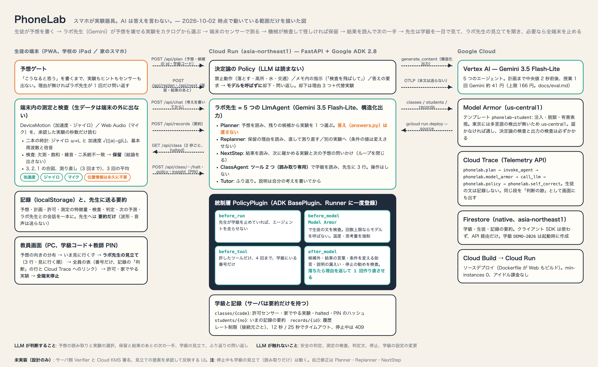

# PhoneLab — スマホが実験器具。AI は答えを言わない。

第 5 回 Agentic AI Hackathon with Google Cloud への提出物。中学校の理科で、生徒が「こうなると思う」を書くと、AI（ラボ先生 = Gemini）がその予想を壊せる実験をカタログから選び、端末のセンサーで測って、機械が検査して怪しければ結論を保留する。判断と解釈はいつも生徒。先生は学級を一目で見て、必要なら全端末を止められる。

- 本番 URL: **https://phonelab-1094091671194.asia-northeast1.run.app**（Cloud Run、asia-northeast1）
- 設計ドキュメント: [`docs/`](docs/README.md)（ペルソナと使う場面、アーキテクチャ、Policy、Verifier、実験カタログ、記録の形）
- 進み方と決定の記録: [`flow.md`](flow.md)



## 動作確認の方法（審査員向け）

テスト用の学級を用意してあります。名前は入れません。

| 項目 | 値 |
|---|---|
| 学級コード | `DEMO-2026` |
| 出席番号 | `S-01` 〜 好きな番号（例 `S-04`）。**最初に入った端末に 6 文字の合言葉が出ます**。別の端末で同じ番号を使うときはその合言葉を入れます（他人の番号に記録を書けないようにするため。合言葉をなくしたら教員画面でリセット） |
| 教員画面 | `/teacher` → 学級コード `DEMO-2026`、教師 PIN `4826` |

### 1. 生徒として（スマホ推奨。PC でも可）

1. 本番 URL を開き、「学級と番号を入れる」→ `DEMO-2026` と番号 → 保存
2. テーマ「音の高さ」（マイクだけで動く）→ 輪ゴムを箱にかけて、はじいてみる → 予想を書く（理由が無いとラボ先生が問い返します）
3. 「ラボ先生に実験を考えてもらう」→ Gemini が予想を読み、実験を 1 つ選びます（2 秒前後）。計画画面に「誰が選んだか」と「答えは渡していません」が出ます
4. 承認 → 「準備はいい？ 3, 2, 1」→ マイクで 5 秒 → 二本の時計（基本周波数と倍音）→ 機械の検査 → 通れば次の条件、怪しければ **保留**
5. 結果は「測定が言っていること」として出ます（「正解」とは言いません）。ふり返りのチャットは、自分の考えを書いてから
6. 試してほしい経路: 予想欄に「スマホを落として測りたい」→ Policy が**モデルを呼ばずに**却下し、理由 3 つと代替実験を出します。「答えだけ教えて」→ 答えは出ません
7. 振り子（加速度センサー）は iPhone / Android / iPad で。先生が「家でやる実験」を有効化すると、トップに「家で」の印で出ます

センサーの無い PC で流れだけ見る場合は、右上の ⚙ 設定 → **テストモード**（サンプルの測定で進めます。記録に「サンプル」と残ります）。

### 2. 先生として（PC 推奨）

1. `/teacher` を開き、学級コード `DEMO-2026` と PIN `4826` を入れる → 5 秒ごとに学級の様子が出ます
2. 上から: 予想の向きの分布（「高くなる 6 人」など）→ **いま見に行く子**（保留 → 却下の順）→ 全員の表（番号だけ）→ 選んだ子の記録の流れ
3. 右上の **「全端末の測定を止める」** → 生徒の端末は 2 秒以内に停止画面になり、ラボ先生（Gemini）も呼ばれなくなります（`/api/plan` `/api/chat` は 409、ADK の `before_run_callback` でも止まる）。解除も同じボタン
4. 許可のトグル（マイク・加速度・カメラ）と「家でやる実験」の有効化も、この画面から

> 審査の期間中（〜2026-12-01）は動作する状態を保ちます。学級 `DEMO-2026` は共用なので、他の人の番号の記録が見えることがあります。

## 何が「エージェント」か（審査軸②）

LLM（Gemini）が判断するのは 3 つだけ。そのすべてを ADK の統制層が囲んでいます。

| 判断 | 誰が | どう囲むか |
|---|---|---|
| 予想を読み、確かめられる実験を選ぶ | **Planner**（`LlmAgent`、構造化出力 `PlanOutput`） | 候補はそのテーマの実験だけ。候補外の id は `after_model_callback` が差し替え。「なぜこの実験か」に結果の言葉が混じれば中立の文に差し替え。答え（`answers.py`）は渡さない |
| 保留の理由を読んで、次の一手（同じ実験で直す／別の実験へ）を提案する | **Replanner**（`LlmAgent`、構造化出力 `ReplanOutput`） | 候補外の実験への切り替えは測り直しに、助言に混じった結果の言葉は中立の文に差し替え。読めなければ検査コードごとの定型 |
| 測定のあとのふり返り | **Tutor**（ラボ先生、`LlmAgent`） | 説明は生徒が自分の考えを書き、判定が出ているときだけプロンプトに入る。閉じている間に説明の言い回しが出たら問い返しに差し替え（保留中は結果の言い回しも） |
| 安全（禁止動作・メモ内の指示・答えの要求） | 決定論の Policy（`server/agent/policy.py`） | **モデルを呼ぶ前に**判定。却下は理由 3 つ＋代替 |
| 測定の検査・判定文・停止・署名 | 端末内の計算とテンプレート | LLM は関与しない |

`PolicyPlugin`（`server/agent/policy_plugin.py`、ADK `BasePlugin`）は Runner に一度登録され、両エージェントに同じ統制がかかる:

- `before_run_callback` — 先生が学級を止めていればエージェントを走らせない
- `before_model_callback` — 回数上限（Planner 5 回 / 実験、Tutor 10 往復 / 記録）ならモデルを呼ばない。温度・出力長・思考量を強制
- `after_model_callback` — 候補外の実験、結果の言葉、説明の漏えいを差し替える

すべて Cloud Trace に `phonelab.policy` スパン（`check` と `decision`）として残ります。生徒の文はスパンに入れません。

## 構成（どこを今回開発したか）

初回コミットは 2026-09-09。すべてこのハッカソン期間中に開発したもので、パッケージ化して配布している部分はありません。

```
phonelab/
├── app/                      実装（Cloud Run にデプロイするもの、Dockerfile が Web もビルド）
│   ├── server/               FastAPI + Google ADK（Python 3.12）
│   │   ├── main.py             /api/plan（Planner）、/api/chat（ラボ先生）、PWA の配信
│   │   ├── routes_class.py     /api/class/*（入場・停止・許可・教員画面の元データ）、/api/records
│   │   ├── classroom.py        学級の保存（Firestore ／ メモリ）、PIN
│   │   ├── ratelimit.py        接続元ごとの回数制限
│   │   ├── telemetry.py        Cloud Trace（本文は送らない）
│   │   └── agent/
│   │       ├── planner.py        Planner の指示・構造化出力・プロンプト
│   │       ├── tutor.py          ラボ先生の指示・プロンプト
│   │       ├── policy.py         決定論の Policy（禁止動作・注入・答えの要求）
│   │       ├── policy_plugin.py  統制層（ADK BasePlugin の 3 コールバック）
│   │       ├── catalog.py        Planner に渡す実験カタログ（答え無し）
│   │       ├── answers.py        先生の説明と漏えい語句（サーバだけが持つ）
│   │       └── runner.py         Runner の組み立て、1 リクエスト = 1 セッション
│   ├── tests/                pytest 71 件（Policy・Plugin・API・学級）
│   └── web/                  PWA（Vite + React + TypeScript）
│       └── src/
│           ├── screens/        12 画面（予想・計画・準備・測定・保留・却下・結果・チャット・記録・教員 など）
│           ├── measure/        端末内の測定と検査（振り子の速さ・周期、音の高さ、二本の時計）
│           ├── flow/           記録を進める操作（予想 → 計画 → 測定 → 判定）
│           ├── agent/          サーバ呼び出し（plan / chat / classroom / sync）と、オフライン時の縮退（stub）
│           ├── catalog/        テーマと実験のカタログ（学習指導要領の参照つき）
│           └── store/          記録・学級・設定（localStorage）
├── docs/                     設計（ペルソナ、ux-flow、architecture、policy、verifier、experiments、record-schema、curriculum-coverage）
├── idea/                     アイデアシート（PDF と元の HTML）
├── context/                  ハッカソンの公式ルールの整理
├── flow.md                   TODO と決定の記録（トップ）
├── LICENSE                   MIT
└── THIRD_PARTY_LICENSES.md   使っている OSS とライセンス
```

Web の vitest は 54 件。実験カタログの id は `web/src/catalog/themes.ts` と `server/agent/catalog.py` で同じ（テストで突き合わせ）。

## 実装済みと、設計だけのもの（正直な線引き）

| できていること（本番で動く） | 設計だけ（`docs/` にあるが未実装） |
|---|---|
| 予想ゲート、Planner（Gemini、構造化出力）、決定論の Policy、PolicyPlugin の 3 コールバック、ラボ先生のチャットと説明のゲート、Cloud Trace | サーバ側の Verifier（いまは端末内の検査だけ。サーバは特徴量の要約を受け取るが再検証しない） |
| 端末内の測定（振り子の速さ・周期、音の高さ）、二本の時計、検査と保留、測り直し、3 回の平均 | Cloud KMS による記録の署名（いまは端末で計算した SHA-256 のハッシュだけ。画面にもそう書いてある） |
| 学級（Firestore）、学級コードで入場、先生の許可・家でやる実験・全端末停止（2 秒ポーリング）、教員画面の実データ | Model Armor（決定論のパターンだけ） |
| 記録の要約のサーバ保存と、先生の 1 画面（分布・見に行く子・記録の流れ） | ClassAgent（教員側の観察と提案。10/1 に Go/No-Go） |
| オフライン縮退（サーバにつながらないときは端末内の規則で選び、記録に「stub」と残る） | 記録の共有 URL（保護者・Classroom 用）、PDF |

## Google Cloud の使い方

| サービス | 用途 |
|---|---|
| **Cloud Run**（asia-northeast1、min-instances 0） | FastAPI + ADK と PWA の配信。`gcloud run deploy --source`（Cloud Build） |
| **Vertex AI — Gemini 3.5 Flash-Lite** | Planner と Tutor。構造化出力、thinking low。1 回 1.4〜2.7 秒。3.8 Flash は 25〜50 秒かかる時間帯があり、生徒を待たせるので不採用 |
| **Agent Development Kit 2.8** | `LlmAgent` × 2、`Runner`、`BasePlugin`（統制層）、`InMemorySessionService`（1 リクエスト = 1 セッション） |
| **Firestore**（native） | 学級 `classes/{code}`、生徒 `students/{no}`（いまの記録の要約）、`records/{id}`（履歴）。クライアント SDK は使わず API 経由だけ |
| **Cloud Trace**（Telemetry API、OTLP） | 1 実験 = 1 トレース。`phonelab.plan → invoke_agent → call_llm → phonelab.policy` |

費用の考え方: Gemini は 1 実験あたり Planner 1〜2 回＋チャット最大 10 往復（Flash-Lite）。接続元ごとにレート制限（plan / chat 30 回 / 10 分、記録 120 回 / 10 分、PIN 10 回 / 10 分）。Cloud Run はアイドル課金なし。

## ローカルで動かす

```bash
# サーバ（Python 3.12、uv）
cd app
PHONELAB_CLASS_STORE=memory PHONELAB_DEMO_PIN=1234 \
GOOGLE_GENAI_USE_VERTEXAI=true GOOGLE_CLOUD_PROJECT=<project> GOOGLE_CLOUD_LOCATION=global \
uv run uvicorn server.main:app --port 8080
uv run pytest -q            # 71 件（Gemini は呼ばない。FakeLlm）

# Web（Vite。/api は 8080 へプロキシ）
cd app/web
npm ci && npm run dev -- --port 5179
npx vitest run              # 54 件
```

環境変数: `PHONELAB_MODEL` / `PHONELAB_CHAT_MODEL`（既定 `gemini-3.5-flash-lite`）、`PHONELAB_CLASS_STORE`（`memory` | `firestore`。Cloud Run 上は既定で firestore）、`PHONELAB_DEMO_PIN`（起動時に学級 `DEMO-2026` を作る）、`PHONELAB_TRACE_TO_CLOUD=1`（Cloud Trace へ送る）。

## ライセンス

MIT（[`LICENSE`](LICENSE)）。使用している OSS とそのライセンスは [`THIRD_PARTY_LICENSES.md`](THIRD_PARTY_LICENSES.md)。
