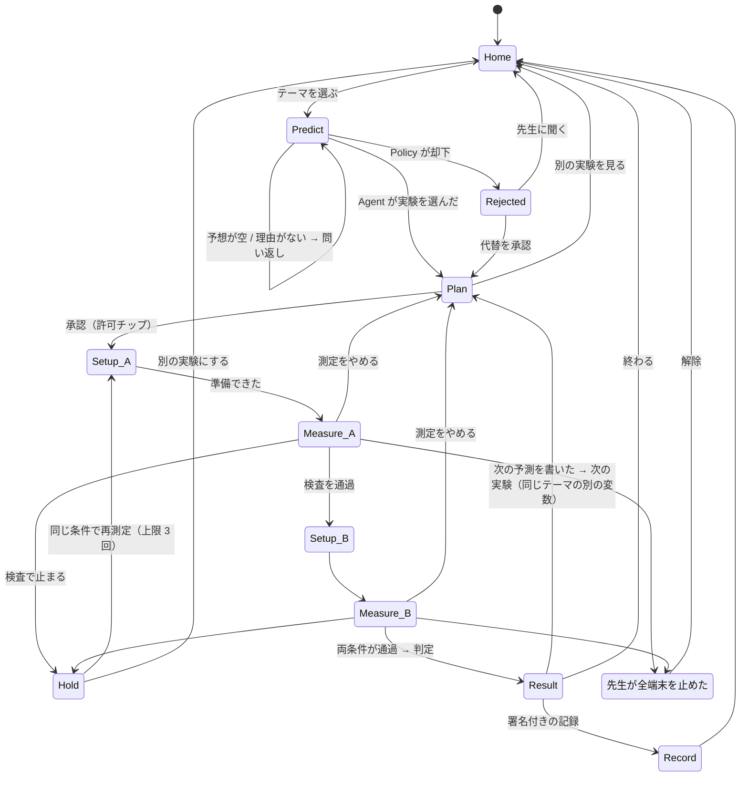

# UX の流れ（生徒）

> 「トップでテーマを選ぶ → 予想を書く → Agent が実験を選ぶ → 許可して測る → 機械が検査 → 判定 → 次の予測」を、一本の記録として往復する。
> 6 画面（`idea/phonelab-idea-sheet.pdf`）はこの流れの中の **状態** であって、入口ではない。入口はトップ。

## 1. 画面の一覧と URL

| URL | 画面 | 役割 |
|---|---|---|
| `/` | **トップ** | 学級と番号、進み方の要約、テーマのカタログ（状態つき）、記録の一覧 |
| `/me` | 生徒の情報 | 学級コード・番号（名前は持たない）、この端末で使えるセンサー、学級の許可（読むだけ）、端末の生データの消去と再検証 |
| `/x/:theme` | 予想 | テーマの説明と「何が要るか」。**予想を書くまで先に進めない**（予想ゲート） |
| `/x/:theme/plan` | 画面 1 計画と承認 | Agent が選んだ実験、変える／一定にする、許可チップ、承認 |
| `/x/:theme/rejected` | 画面 5 Policy 却下 | 危険・カタログ外・注入の要望を却下し、理由と代替 |
| `/x/:theme/setup/:cond` | 条件の準備 | 「消しゴムを 2 個にして、同じ振れ幅で」。準備できたら測る |
| `/x/:theme/measure/:cond` | 画面 2 測定と検査 | 秒数カウント → 二本目の時計 → 機械の検査 |
| `/x/:theme/hold` | 画面 4 保留 | 検査で止まった理由と再測定の提案 |
| `/x/:theme/result` | 画面 3 結果と次の予測 | 測定が言っていること、自分の説明、次の予測（三択） |
| `/records/:id` | 画面 6 署名付き実験記録 | 一本の記録と署名、端末で再検証 |
| `/halted` | 停止 | 先生が全端末を止めたとき。センサーは読まない |
| `/teacher` | 教員画面 | 学級の許可・上限、全端末停止、生徒ごとのトレース、提案の承認 |

## 2. テーマと実験の粒度

- **テーマ** = カタログに並ぶ単位（振り子の周期、自由落下、ペットボトルの音、うなり、反響、コインの滑り出し、ジャンプ ＋ 拡張 3）。生徒が選ぶ
- **実験** = テーマの中で「何を変えるか」を決めたもの（振り子なら 重さ／長さ／振れ幅）。**Agent が予想を読んで選ぶ**。生徒は選ばない
- **条件** = 実験の A と B（重さ 1 倍 → 2 倍）。順に測る
- **記録** = 予想 → 計画 → 許可 → 測定 A/B → 検査 → 判定 → 次の予測 の一本。テーマ 1 つに複数の記録がありうる（重さの次に長さ）

だから「好きな実験を選ぶ」はテーマの選択であり、「Agent が予想を壊せる実験を選ぶ」はテーマ内の変数の選択。PDF の一枚目の言い方と両立する。

## 3. トップに出す状態

テーマカードの状態は記録から導く。**終わったものは終わったと出す**。

| 状態 | 表示 | 導出 |
|---|---|---|
| 未着手 | 「はじめる」 | 記録なし |
| 進行中 | 「予想の続き」「承認待ち」「測定 A」「測定 B」 | `open` の記録の現在の段階 |
| 保留中 | 「保留 再測定できます」 | `held` |
| 判定済み | 「次の予測を書く」 | `judged`（次の予測がまだ） |
| 完了 | 「✓ 署名済み」＋変えたもの（重さ ／ 長さ） | `signed`。テーマ内に複数あれば「2 / 3」 |
| この端末では不可 | 灰色＋理由「加速度センサーがありません」 | 端末能力 |
| 学級で不可 | 灰色＋理由「カメラは学級で不可」 | 学級の許可 |
| 先生が有効化 | 灰色＋「先生に聞く」 | `enabled_by: teacher` |

危険な実験はカタログに存在しないので、灰色にもならない（候補にも出さない）。

## 4. 状態遷移

## 5. 各画面の中身（何を埋め込むか）

### トップ `/`
- 見出し「PhoneLab」＋右上に「2年3組 S-04」チップ（タップで `/me`）。未設定なら「学級コードと番号を入れる」カードが最上部
- 「今日の進み方」: 完了 n ／ 保留 n ／ 全テーマ数。停止中なら紺の帯「先生が測定を止めています」
- テーマのカタログ（カード）: タイトル、一言（予想の例）、要るもの、センサーのチップ、秒数、状態バッジ。灰色のカードは理由を出す
- 「記録」: 署名済みの記録を新しい順に。タップで `/records/:id`

### 予想 `/x/:theme`
- テーマの一言説明と、要るもの・センサー・安全（カタログから）
- 「振り子を見て、どう思う？」の下に **自由記述**（橙の枠）。理由も書くよう促す
- 「Agent に実験を選んでもらう」ボタンは空なら押せない
- 「答えだけ教えて」に当たる入力には、ヒントの上限を消費して予想を促す文を返す（Policy 3.7）
- Agent が理由を求めた場合は同じ画面に問い返しを出し、書き足させる

### 画面 1 `/x/:theme/plan`
- PDF どおり。**変える／一定にする** はカタログの実験定義から。**許可チップ** は plan の sensors と seconds から
- 「この実験を承認して測る」→ 許可（iOS はここでダイアログ）→ `/setup/A`
- 「別の実験を見る」→ トップへ（記録は `open` のまま残る。トップで「承認待ち」と出る）

### 条件の準備 `/x/:theme/setup/:cond`
- 「重さ 1 倍」「重さ 2 倍」の指示（カタログの `procedure`）。イラストは線画 1 枚
- 「準備できた、測る」→ `/measure/:cond`。ここで初めてセンサーを読み始める

### 画面 2 `/x/:theme/measure/:cond`
- カウント、二本目の時計、検査。検査後に「次へ」（通過）か「検査の結果を見る」（保留）
- 「測定をやめる」→ 記録に `stop` を残して `/plan` へ

### 画面 4 `/x/:theme/hold`
- 検査コードから理由文（verifier.md 4 章）。「同じ条件で再測定」→ `/setup/:cond`。3 回目でボタンが消え「別の実験にする」だけ

### 画面 3 `/x/:theme/result`
- A と B の値、判定文（テンプレート）、自分の説明、次の予測（三択）
- 次の予測を選ぶと「次の実験へ」が出る → 同じテーマの別の変数で `/plan`（新しい記録）。全変数が終わっていればトップへ
- 下に「署名付きの実験記録」「トレースを見る」

### 画面 6 `/records/:id`
- 記録のタイムライン、署名、端末で再検証。トップからも来られる

### 停止 `/halted`
- 「先生が学級の測定を止めました」。センサーは読まない。解除されたら「トップに戻る」

### 生徒の情報 `/me`
- 学級コード・番号の変更、この端末のセンサー、学級の許可（読むだけ）、生データを消す、端末で再検証

## 6. 保存する場所

| もの | いま（サーバ未実装） | あと |
|---|---|---|
| 学級コード・番号 | `localStorage` | 同じ |
| 記録（予想、計画、測定の特徴量、検査、判定） | `localStorage`（record-schema.md と同じ形） | Firestore（サーバ経由） |
| 生データ | IndexedDB（直近 10 実験） | 同じ（端末から出ない） |
| Agent の実験選択、判定文 | 端末内のスタブ（キーワードで変数を選ぶ） | Planner（Gemini）＋ Verifier/Judge（サーバ） |

スタブは `src/agent/stub.ts` に隔離し、サーバができたら同じ関数シグネチャで API 呼び出しに差し替える。

## 7. 疑って確かめたこと（レビューの記録）

- 「Agent が実験を選ぶ」と「生徒が実験を選ぶ」が矛盾しないか → テーマ／実験／条件の 3 層に分けて解消（2 章）
- 予想ゲートはどこで効くか → `/x/:theme` で空なら進めない。トップから `/plan` に直接来ても記録に予想が無ければ `/x/:theme` に戻す
- 保留が無限に続かないか → 条件ごとに 3 回で打ち切り（Policy 3.6 の `remeasure_per_condition`）
- 「別の実験を見る」で記録が消えないか → `open` のまま残し、トップで「承認待ち」。同じテーマを開くと続きから
- 次の予測のあと何が起きるか → 同じテーマの未実施の変数で新しい記録。全部終わったらテーマは「完了 3 / 3」
- センサーの無い端末（ChromeOS）でどうなるか → カタログが灰色になり理由が出る。マイク・カメラのテーマだけ残る
- 停止中に測れないか → `/measure` は停止フラグを見て `/halted` へ。センサーを読む前に判定
- 名前を持たないか → 学級コードと番号だけ。`/me` にも名前欄は無い
- トップに戻る導線が全画面にあるか → ヘッダの「PhoneLab」がトップへのリンク。測定中だけは無効（誤タップで測定が壊れないように）

## 8. 実機（ブラウザ）で一周して直したこと（2026-09-09）

Chrome の開発サーバで、トップ → 生徒の情報 → テーマ → 予想 → 計画 → 準備 A → 測定（PC なのでデモ）→ 準備 B → 測定 → 結果 → 次の予測 → 次の実験の計画 → 測定 ×2 → 結果 → 記録 → トップ、を実際に通し、さらに却下・ヒント・保留・停止・「別の実験を見る」の 5 経路を確かめた。

| 見つけた問題 | 直し |
|---|---|
| 描画中に記録の作成・判定・リダイレクトをしていた（React の副作用違反。StrictMode で記録が二重にできる） | `resolve()` で「リダイレクト先」と「描画前にやること」を決め、`useEffect` で実行。作成は既存があればしない |
| センサーの無い端末で 20 秒待たされる | 2 秒で 1 サンプルも来なければ打ち切り、「サンプルの測定で進む（デモ）」を出す。demo フラグは記録に残る |
| 「測れません」状態でも右上が「2 測定中」 | 状態ごとにバッジを変える |
| トップの「完了」がテーマ数で紛らわしい | 「終わった実験」＝署名済みの記録数に |
| 記録画面が「サーバが署名しています」と言っていた | 端末ハッシュのときは「サーバの署名は実装後」と書く |
| 許可イベントにセンサー名が無い | 「加速度・ジャイロを 20 秒 × 2 回。マイク・カメラ・位置は使わない」 |
| 保留画面の通過項目に「欠測なし（58 Hz）」が出て、失敗理由「0.5 秒の欠測」と矛盾 | サンプリングの行は「サンプリング 58 Hz」に |
| 保留中のテーマをトップから開くと準備画面に行く | 保留画面へ |
| 学級と番号が未設定でもテーマカードが押せないだけで理由が無い | 押すと生徒の情報へ。カードに説明 |

確認できた挙動: 予想ゲート（短い予想は問い返し）、ヒント要求は答えず回数を数える、危険・注入の要望は却下と代替、検査失敗は保留と再測定（3 回で打ち切り）、先生の停止で準備・測定に入れない、「別の実験を見る」で記録が「承認待ち」として残り続きから開ける、テーマの「2 / 3」表示。

まだ端末内スタブのもの: Agent の実験選択（キーワード）、Policy、判定文、署名（端末ハッシュ）。サーバ実装（flow.md フェーズ C・D）で差し替える。
