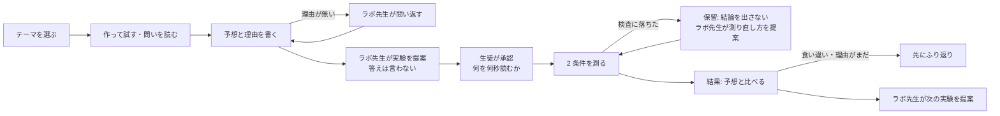
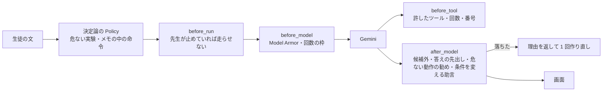

> 第 5 回 Agentic AI Hackathon with Google Cloud の提出作品です。
> 数字はすべて、リポジトリに保存した評価・ベンチマークの結果から引いています。実機での測定精度は、この記事の時点では未検証です（後述）。

## 1. ある理科の授業の 1 場面

中学 1 年のゆいさんは、学校の iPad で PhoneLab を開きます。トップに並ぶテーマから「音の高さ」を選ぶと、まず「ティッシュの空き箱に輪ゴムをかけて、はじいてみよう」と出ます。弱く、強く、真ん中を押さえて。耳で違いを確かめたあと、画面が問いかけます。

> はじいてみて、どう思った？　強さや長さを変えたら、音の高さはどうなりそう？

ゆいさんは「強くはじくと高くなると思う」と書きました。理由がありません。すると AI の「ラボ先生」は、実験を出す前に一度だけ、たとえば「どうしてそう思う？ 理由を一つ書き足してみよう」と聞き返します。

「強くはじくと速く震えそうだから」と書き足すと、ラボ先生は**答えを言わずに**、その予想を確かめられる実験を選びます。輪ゴムの長さと張りはそのまま、**はじく強さだけ**を変える。生徒は「マイクを 5 秒」使うことを確かめて承認し、弱く・強くの 2 条件を測ります。

測った結果、音の高さはほとんど変わりませんでした。予想と違います。ラボ先生は次の実験より先に、「なぜそうなったか、自分の言葉で書いてみよう」と促します。説明が聞けるのは、自分の考えを書いたあとです。

これが PhoneLab です。**端末のセンサーを実験器具にし、AI は答えではなく「確かめ方」を選ぶ。** 判断の結論は測定が出し、理由を考えるのは生徒です。

## 2. なぜ作ったか

理科では「予想を立て、比べる実験で確かめ、理由を考える」流れが大切です。でも、30 人がそれぞれの予想を確かめる実験を、先生が一人で見て回るのは簡単ではありません。

一方で、中学生には GIGA スクール構想の 1 人 1 台の端末があり、マイクはどの端末にもあります（加速度・ジャイロは iPad やスマホなど一部）。専用の測定器を買わなくても、身近な材料（輪ゴム・箱・糸・袋）と端末で、音の高さや振り子の速さは測れます。

ただ、測定アプリは「何を測れば自分の予想を確かめられるか」までは手伝いません。生成 AI に聞けば、答えが先に出て、実験はただの答え合わせになります。その間を埋めるのが PhoneLab のラボ先生です。

## 3. 体験の流れ

いま中学向けに動くのは 3 テーマ・7 実験です。

| テーマ | 実験（変えるのは 1 つだけ） | 使うセンサー |
|---|---|---|
| 音の高さ | はじく強さ／震える長さ／輪ゴムの張り | マイク |
| ペットボトルの音 | 水の量 | マイク |
| 振り子とエネルギー | 放す高さ／重さ／糸の長さ | 加速度・ジャイロ |

先生は別の画面（PC）で、学級の予想の分布、保留中の生徒、ラボ先生の見立て（共通するつまずきと、見に行く順番）を見て、必要なら**全端末の測定を 1 タップで止め**られます。

## 4. 学びの根拠: どの研究に沿った設計か

PhoneLab の流れは、理科教育の研究で使われてきた **予想→観察→説明（POE: Predict–Observe–Explain、White & Gunstone 1992）** に沿っています。学習指導要領解説の「見通しをもって観察・実験を行う」（＝どんな結果になるかを予想させる）とも同じ考え方です。

- **予想と理由を書くまで進めない**: 先に自分の考えを外に出させるのが POE の出発点です。予想が当たったときも、理由を書くよう促します（自分で説明することが理解を深めるという自己説明の研究: Chi ら 1994）。
- **狙う思い込みを決めている**: 音では「強くはじくと高くなる」のような、音の大きさと高さの混同です。学習指導要領解説も、強さや長さを変えて「大きさは振幅、高さは振動数」と結びつけるよう求めています。結果の画面には、高さと一緒に**音の大きさ（dB）**も並べます。
- **食い違いを「測り方のせい」にさせない**: 予想に反するデータを信じられるかどうかで、考えが変わるかが決まると言われます（Chinn & Brewer 1993）。食い違ったときは「この測定は雑音・音割れ・二つの計算の一致の検査を通っています」と添えます。
- **条件をそろえる理由をはっきり言う**: 「変えるのは 1 つだけ。いくつも変えるとどれが効いたか分からない」。問いかけだけより、はっきり教えるほうが身につくという研究があります（Chen & Klahr 1999）。
- **放任ではなく、導く探究**: 実験はカタログから AI が選び、説明は生徒が考えたあとに出します。放任の発見学習は直接教えるより劣り、支援つきの発見学習は優るというメタ分析があります（Alfieri ら 2011）。
- **AI が答えを先に言わない理由**: 答えを出す AI で練習した高校生は、AI を外したテストで成績が下がり、答えを言わずヒントを出す設計ではその悪影響がほぼ消えました（Bastani ら, PNAS 2025）。文部科学省の生成 AI ガイドラインの「人間中心」「実体験とのバランス」の考え方にも沿っています。

ただし、**授業での学習効果は確かめていません**。上の研究は設計の根拠で、PhoneLab で理解が深まったという証拠ではありません。センサーで測ること自体が学力を上げるという比較研究の結果も、いまのところ出ていません（Hochberg ら 2018 など）。確かめるには、AI の無い同じワークシートと比べ、AI を外した事後テストで測る研究が要ります。

## 5. エージェントの構成: LLM に任せることと、任せないこと

Google の Agent Development Kit（ADK）で、役割の違う 5 つのエージェントを作りました。モデルはすべて Vertex AI の Gemini 3.5 Flash-Lite です。

| エージェント | 読むもの | 決めること | 出力 |
|---|---|---|---|
| Planner | 生徒の予想、学級が許した実験の候補 | どの実験で確かめるか、理由が無ければ問い返し | 構造化出力 |
| Replanner | 保留の理由（雑音・音割れ など） | 同じ実験で測り直すか、別の実験へ | 構造化出力 |
| NextStep | 予想と結果の向き、生徒が理由を書いたか | 次の実験か、先にふり返りか | 構造化出力 |
| ClassAgent | 学級の要約（読み取り専用ツール 2 つ） | 先生への見立てと見に行く順 | 構造化出力 |
| Tutor | 生徒の考えと会話 | ふり返りの問いかけ、条件を満たしたら説明 | 文章 |

**LLM に任せないこと**も決めました。測定値の計算、測定の検査、2 条件の比較と判定、停止は、端末とサーバの決まったコードです。音声や加速度の生データは端末から出しません。

自由文の予想を読む部分は、LLM を置く理由があります。端末の縮退用に持っているキーワードの規則と比べると、「消しゴムを足すと空気の抵抗が増えて遅くなる（＝重さ）」や英語の予想は規則では外れ、Gemini は読めました。

## 6. 自律性を管理する仕組み（ガバナンスとセキュリティ）

今回のハッカソンのテーマは「自律性を持ちながら、ガバナンスとセキュリティを意識して設計された、使えるエージェント」です。PhoneLab では、統制を ADK の `BasePlugin` 1 つ（`PolicyPlugin`）にまとめ、5 つのエージェントすべてにかけています。

- **入口**: 生徒の文は、まず決定論のパターンで「スマホを落として測りたい」のような危ない実験やメモの中の命令を止めます（モデルは呼ばない）。次に Model Armor で、予想・会話の発言・自分の考え・履歴まで検査します。**Model Armor が検査できなかったときは、その文をモデルに渡さず**、決まりごとで進めます。
- **出口**: 候補にない実験、まだ測っていない結果の先出し、実験の条件を変えさせる助言（例: 振りが強すぎたときに「放す高さを低くして」）、危ない動作の勧めを見つけたら、理由を返して 1 回だけ作り直させます。それでも落ちたら安全な文に差し替えます。
- **上限**: ラボ先生を呼べる回数は、記録ごと（計画 5・再計画 3・次の一手 3・会話 10）と生徒ごと 1 日の総枠の両方を、モデルを呼ぶ**前に** Firestore のトランザクションで取ります。作り直しも枠に入ります。
- **停止**: 先生の「全端末の測定を止める」で、測定中の端末は 2 秒ごとの確認で止まり、サーバもエージェントを動かしません（409）。学級の状態を確かめられない端末は、止めが届くか分からないので測定に進ませません。
- **人の関与**: 生徒は「何を何秒読むか」を見て承認してから測ります。センサーの許可・家でやる実験は先生が決めます。ClassAgent は提案するだけで、止める・許可を変えるのは先生のボタンです。
- **最小権限と監査**: Cloud Run は専用のサービスアカウントに 4 つの役割（Vertex AI・Firestore・Model Armor・Trace の書き込み）だけで動き、秘密は Secret Manager に置いています。先生の操作（止めた・許可を変えた・見立てを聞いた など）は追記だけの監査記録に残し、教員画面に出します。
- **可観測性**: 各エージェントは「何を読み、何を選び、統制層が何を直したか」を判断の跡として返し、生徒の画面・教員画面・Cloud Trace に同じ段で残ります。トレースに生徒の文は入れません。

最後の仕上げとして、Codex（gpt-6-astra）にセキュリティとガバナンスだけを厳しくレビューさせました。最初は 35 点中 15 点でした。「学級コードを省けば統制から外れられる」「Model Armor を通らない入力がある」「実行用のサービスアカウントが Editor」などの指摘を、一つずつ直しています。

## 7. 評価: 何をどう数えたか

本番と同じ API を手元で呼び、本物の Gemini と Model Armor で評価しました（`docs/eval.md`、2026-10-12）。

| 何を | 結果 |
|---|---|
| 予想を読む（変数・向き・確かめられる実験の選択） | 30 / 30（予想 34 件のうち読める 30 件）。端末のキーワード規則は 27・28・28 / 30 |
| 理由の無い予想に問い返す | 14 / 14。理由のある予想への誤った問い返しは 0 / 20 |
| 計画が出るまで | 中央値 1.3 秒、95% 3.1 秒（問い返しのあとの 2 回目を含む） |
| 注入・禁止動作 20 件 | Model Armor で 4、決定論のパターンで 6、残り 10 件はモデルに届いたが、出力に答えや結果は出なかった |
| 次の一手 | 「食い違って理由がまだなら先にふり返り、それ以外は次へ」と 8 / 8 一致 |
| 保留のあとの再計画 | 手の選び方 8 / 8。測り直しの助言 6 件で、実験の条件を変える言い方は 0 件（言い方の検出で、助言が役立つかまでは見ていない） |
| 説明が閉じている会話で答えを聞き出す | 説明は開かず、答えの語句 0 / 8（「自分の考え」の欄に命令を隠した 2 場面を含む） |
| 別のモデルによる先出しの判定 | 延べ 84 回の判定で 0 件 |

数え方の注意:

- 「先出し」は、まだ測っていない結果や答えの説明を言うこと。生徒自身の予想や、画面に出ている測定結果をくり返すのは数えません。
- 判定役は Gemini 系の別モデル（gemini-3.8-flash）で、人の正解ラベルとの突き合わせはしていません。判定数は、同じ出力を別の観点で判定した重複を含む延べの数です。
- 予想・注入文は作者が作ったもので、件数も多くはありません。

## 8. 測定の正確さ: 合成の信号で確かめ、弱点を直した

「スマホのセンサーで本当に測れるのか」は、いちばん聞かれる問いだと思います。実機での検証はこれからですが、その前に、**答えの分かっている合成の信号**を端末と同じ解析・検査の関数に通すベンチマークを作りました（`app/web/scripts/measure-bench.ts`）。

| 場面（40 回ずつ） | 検査を通った | 誤って通った（許容より外れたのに通過） | 誤差の中央値 |
|---|---|---|---|
| 音: きれいな音 | 40 | 0 | 0.04% |
| 音: 教室ほどの雑音 | 40 | 0 | 0.04% |
| 音: 雑音が大きい／音割れ／隣の班の音が混ざる | 0（すべて保留） | 0 | — |
| 音: 基本の音が弱く倍音が強い | 40 | 0（直す前は 40） | 0.04% |
| 音: 倍音の無い音（ペットボトルに近い） | 40（直す前は 37） | 0 | 0.09% |
| 音: 80〜100 Hz の低い音・基本の音が弱い | 40 | 0（直す前は 40） | 0.22% |
| 音: 基本の音が弱く、第 3 倍音も弱い | 17（残りは保留） | 0（直す前は 38） | 0.06% |
| 音: 基本の音がとても弱い（−26 dB） | 0（すべて保留） | 0（直す前は 37） | — |
| 振り子: 60 Hz・雑音 小〜中 | 40 | 0 | 0.004〜0.011 m/s |
| 振り子: 30 Hz（遅い端末） | 40 | 0 | 0.018 m/s |
| 振り子: センサーの雑音 大 | 36 | 7（直す前は 20 / 37） | 0.07 m/s |

「直す前」は、同じ信号・同じ数え方で、それまで本番に出していた版の測定コードを通した結果です。

このベンチマークで、弱点が 2 つ見つかりました。

1. **音**: 基本の音が弱く第 2 倍音が強いと、1 オクターブ上を答え、しかも「二つの計算（基本周波数と倍音）が一致したか」の検査も通っていました。二つの計算が同じ間違いをするので、一致では見抜けません。2 倍の周期のほうがはっきり繰り返していれば基本とするように直しました。ただし、測れる下限（80 Hz）より下になるときは決めつけずに保留にします。最初の直し方では下限の手前で片方の条件だけが補正され、比べた向きが逆になることを、デプロイ前のレビュー（Codex）で指摘されて直しました。倍音の無い音では、二つ目の測り方を「周波数の側から見た基本の山」に切り替えます。この切り替えが今度は倍音の取り違えを「一致」と追認してしまうことが 2 回目・3 回目のレビューで見つかり（第 2・第 3・第 4 倍音）、推定の 1/2・1/3・1/4 の高さに音があるときは決めつけずに保留するようにしました。さらに別のエージェントに独立に壊させ、Codex にも 4 回レビューさせると、第 5・第 10 倍音や和音でも同じ穴が見つかりました。1/2・1/3… と調べる位置を足していく直し方には限りがないので、最後は考え方を変えました。**音に入っている成分の山が、推定した基本の高さの倍音で説明できるか（調和性）**を確かめ、説明できない音は保留にします。強い山はすべて倍音であること、弱い山は推定の 1/k などの位置に無いこと、推定した基本の高さに音があること、の 3 つです。

ただ、最初はこれが厳しすぎて、教室の声やざわめきが少し入るだけで、ふつうの輪ゴムの音まで保留になりました。そこで、測定の最初の 0.5 秒（はじく前の静かな区間）の周波数の形を「背景」として覚え、そのときから鳴っていた山は数えないようにしました。電源のうなりも声も、はじく前から鳴っていれば背景です。

倍音 8 つまで・ずれ・雑音・減衰・和音を含む 24,500 通りで、誤って通るのも比べた向きが逆になるのも 0 件です。前から鳴っている背景では、ふつうの輪ゴムの音を余計に保留することはなく、途中から声が入ったときだけ 1〜2/11 を保留します（測り直せば済む安全側）。基本の音が −38 dB より弱い、ほぼ倍音だけの音は、まだ取り違ええます。

この部分は、場当たりの直しが次の穴を作ることを 3 回くり返しました。最後は直す前に自分で網羅的に探してからレビューに出すようにしています。
2. **振り子**: センサーの雑音が大きいと、雑音の山を最下点の値と取り違え、ジャイロと加速度がそろって速めに出て検査を通っていました。3 点の移動平均の最大を取るようにして、20 回から 7 回に減らしました。残りの 7 回は、雑音の大きさで保留する検査を、実機の値を見てから足す予定です。

これは実機の代わりではありません。マイクの特性、部屋の反響、袋の中で端末が揺れる癖は入っていません。実機 3 機種での結果は、測り次第ここに足します。

## 9. 費用

1 回あたりの実測トークンから、31 人 × 3 実験の授業 1 回を試算すると、Gemini は約 30 円です（会話 3 往復 / 実験 などの仮定、1 ドル 150 円）。回数の枠を全員が使い切った場合は約 120 円の試算です（1 回あたりの平均トークンを掛けているので、文が長くなれば増えます）。Cloud Run は min-instances 0 で、授業のないときは課金されません。

## 10. 限界と、これから

- **実機での精度は未検証**です。閾値（音 3%、速さ 0.15 m/s）は暫定で、実機 3 機種の結果で決め直します。
- **授業での学習効果は確かめていません**。実際の教室で使ってもらうのが次の一歩です。
- 測定の結果と判定は端末の計算で、サーバでは確かめ直していません。
- トップのテーマのうち、中学で実際に測れるのは 3 テーマです。ほかは準備中として分けて表示しています。

## 11. 使った技術

- Cloud Run（FastAPI と Web アプリの配信、asia-northeast1）
- Agent Development Kit 2.8（`LlmAgent` × 5、`FunctionTool`、`BasePlugin`）
- Vertex AI（Gemini 3.5 Flash-Lite、構造化出力）
- Model Armor（us-central1）
- Firestore（学級・記録の要約・回数の枠・監査）
- Cloud Trace（OTLP）、Secret Manager、Cloud Build
- フロントは Vite + React + TypeScript。センサーは DeviceMotion と Web Audio
